# 拾序 · Shixu


用月历安排事情，用番茄钟记录学习，用桌面小组件随时查看待办。

拾序是一款面向个人使用的 Windows 原生软件，数据保存在本机，无需登录。基于 C# / WPF / .NET Framework 4.8，便携运行，无第三方运行依赖。

**当前版本：v2.2.3 · Windows x64**

[下载便携版](https://github.com/XiongWen04/shixu/releases/latest) · [使用说明](docs/使用说明.md) · [版本记录](https://github.com/XiongWen04/shixu/releases)

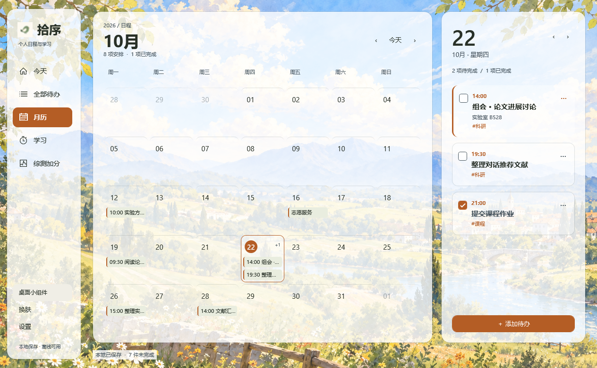

## 开始使用

推荐 Windows 11 64 位；Windows 10 64 位需已安装 .NET Framework 4.8。

1. [下载 v2.2.3 便携包](https://github.com/XiongWen04/shixu/releases/download/v2.2.3/Shixu-v2.2.3-win-x64-portable.zip)，解压到有写入权限的文件夹。
2. 运行 `拾序.exe`，保留旁边的 `拾序.exe.config`。
3. 打开“月历”选择日期，点击右侧“添加待办”；也可以点击顶部“添加”或按 `Ctrl+N`。
4. 需要学习时，打开“学习”，选择倒计时或正向计时，填写名称后开始。

关闭主窗口会隐藏到后台，计时和提醒继续运行；彻底退出请使用托盘菜单中的“退出”。下载包不含预置任务和个人设置。

## 核心功能

| 功能 | 可以做什么 |
| --- | --- |
| 待办管理 | 新增、编辑、完成、删除与撤销最近一次删除；支持日期、时间、地点、备注、标签和重要标记 |
| 日程视图 | “今天”查看当天及逾期事项；“全部”搜索、按标签筛选和折叠重复任务；“月历”按日安排 |
| 重复与提醒 | 每天、每周、每月重复，各次独立操作；到点显示无声音、不抢焦点的小通知 |
| 学习计时 | 倒计时、正向计时、暂停继续与提前结束，保存实际学习时长 |
| 学习回顾 | 每日目标、7 天趋势、30 天热力图、学习名称排行、历史筛选及自然周 / 月报告 |
| 桌面小组件 | 查看今天和逾期任务，直接完成或添加；自由拖放、缩放，记住位置 |
| 外观与数据 | 蓝白、暖色、深色三套主题，自定义图片背景；本地备份、导入导出和数据目录迁移 |

普通待办与学习计时独立：完成参会、组会或生活安排不会增加学习时长。当前不提供账号、云同步或多人协作。

## 界面预览

以下截图使用独立示例数据，不会写入你的清单；日期随截图时的系统日期显示。

### 安排待办

月历左侧显示整月大网格，右侧查看所选日任务。点击“添加待办”打开完整弹窗，默认日期跟随所选日；可填写时间、地点、标签、备注、提醒和重复规则。

“今天”集中查看当天和逾期事项，“全部”管理所有任务，支持搜索与标签组合筛选。已完成任务保留记录。

<details>
<summary>查看今天、编辑弹窗与搜索界面</summary>

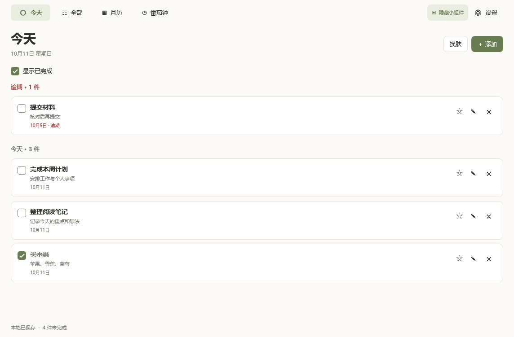

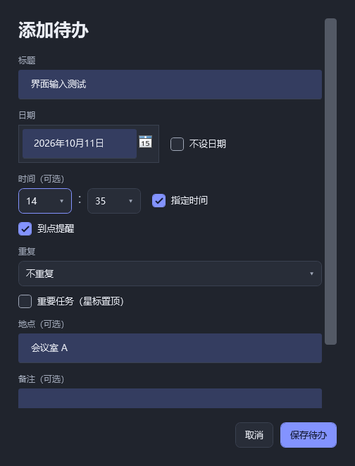

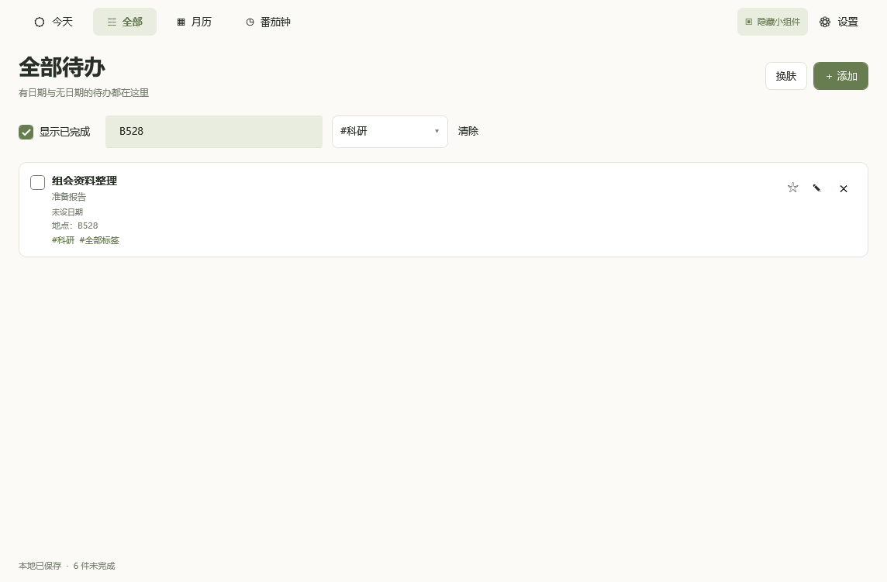

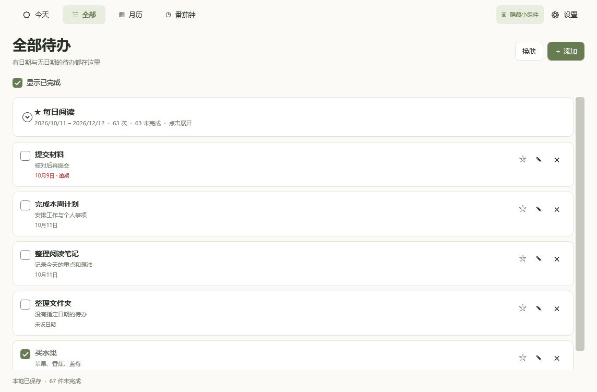

</details>

### 记录学习

学习页采用居中半透明计时卡片，底部显示每日目标和今日已学，下方“今日学习记录”可展开。倒计时支持 1–720 分钟，正向计时无需预设时长。

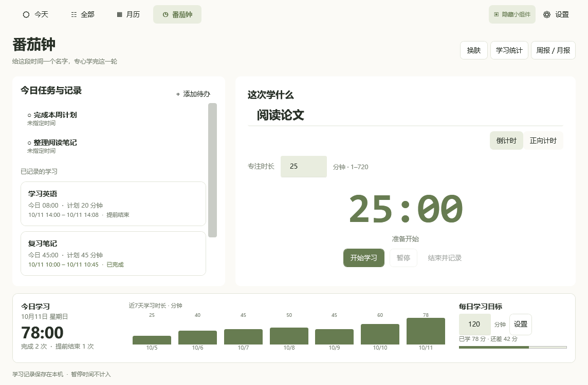

统计按实际计时累计，暂停不计入，提前结束只记录已学部分，跨午夜分别归入各天。查看统计不会暂停计时；周报与月报可回顾总时长、学习天数及主要学习内容。

<details>
<summary>查看学习统计、历史记录与报告</summary>

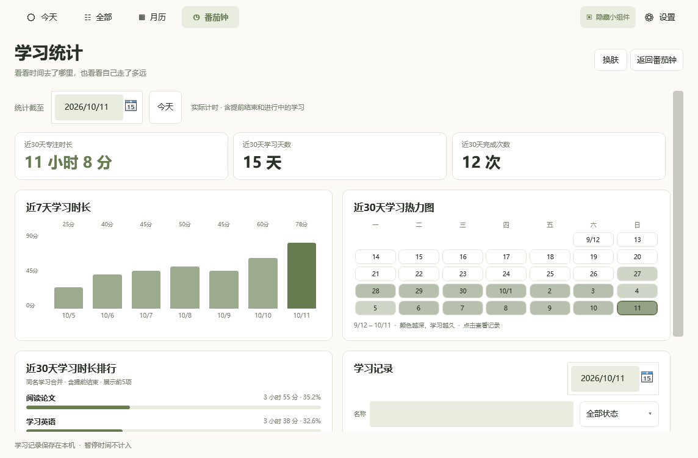

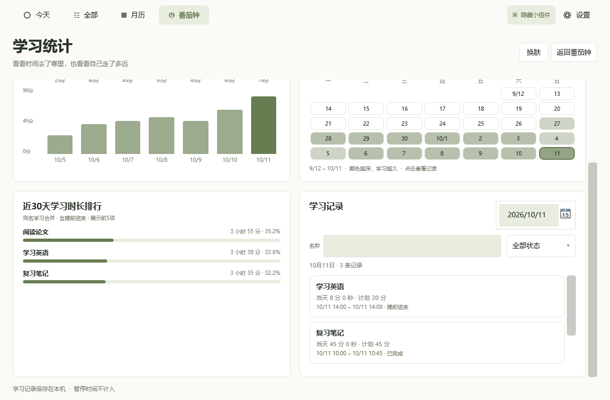

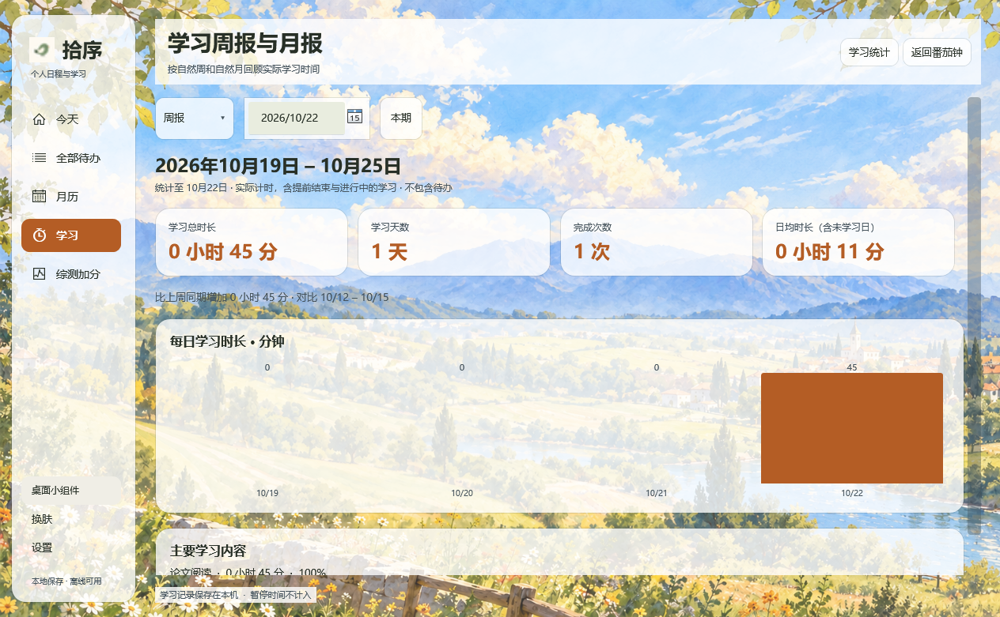

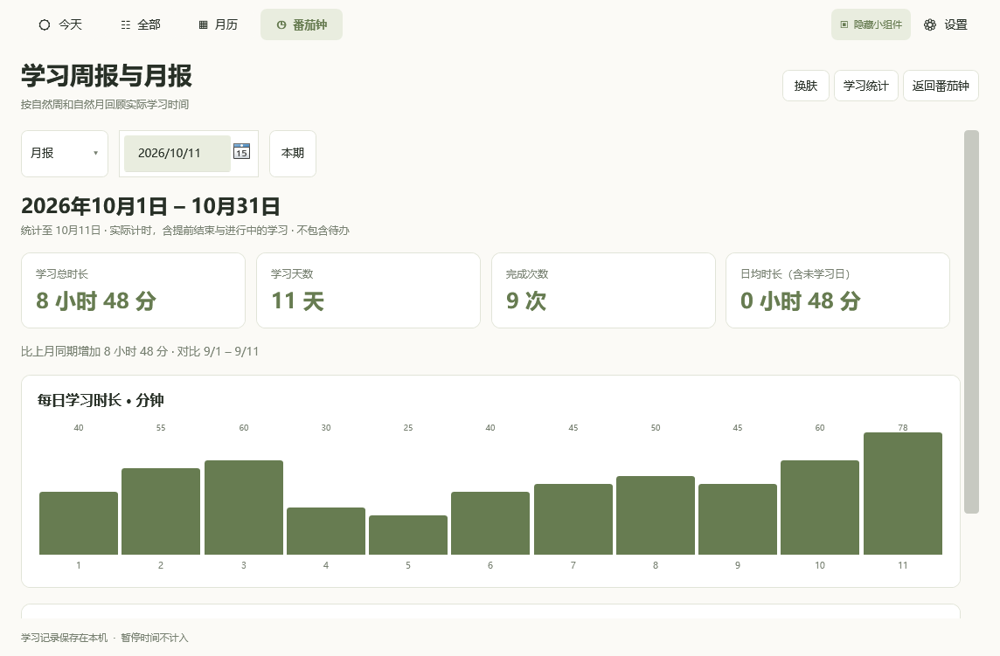

</details>

### 桌面小组件与外观

小组件使用模糊壁纸与半透明色层，可拖动顶部移动、拖动右下角缩放。关闭主窗口后仍可查看和操作待办。

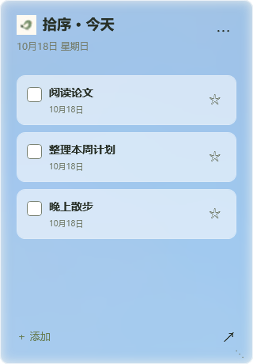

“换肤”菜单提供三套主题，也可以选择本地 PNG、JPG 或 BMP 图片作为主窗口背景，并调整遮罩强度。背景会保存副本，移动原图不影响使用。

<details>
<summary>查看主题与自定义背景</summary>

| 蓝白 | 深色 |
| --- | --- |
| 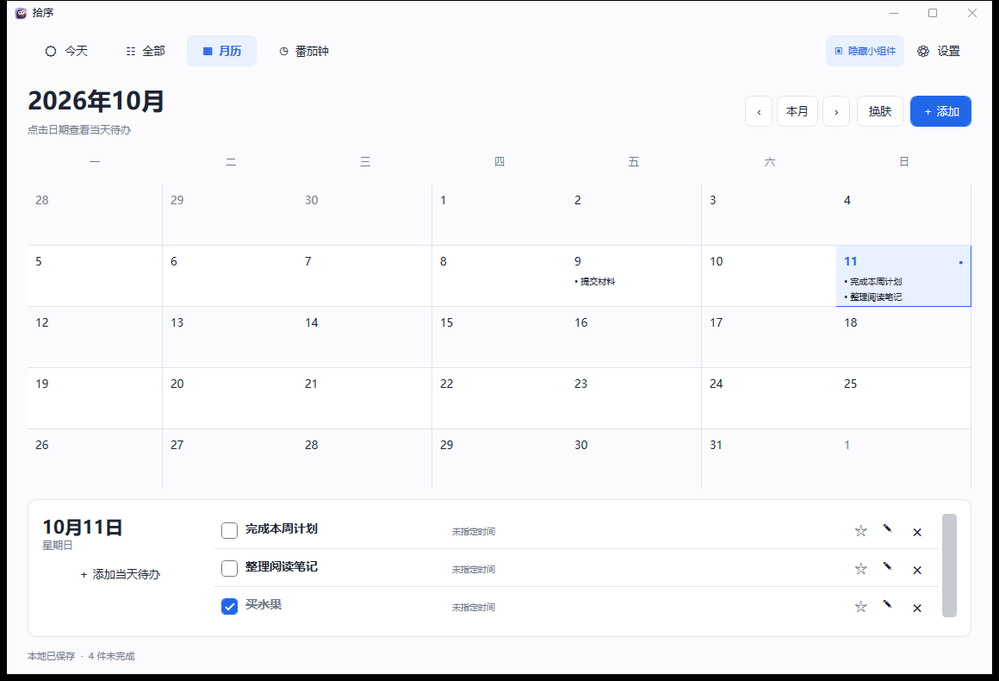 | 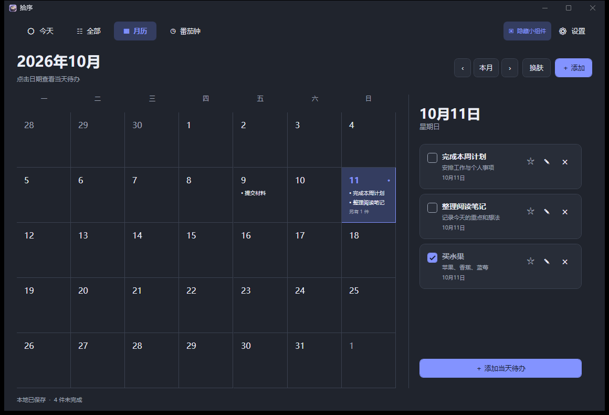 |

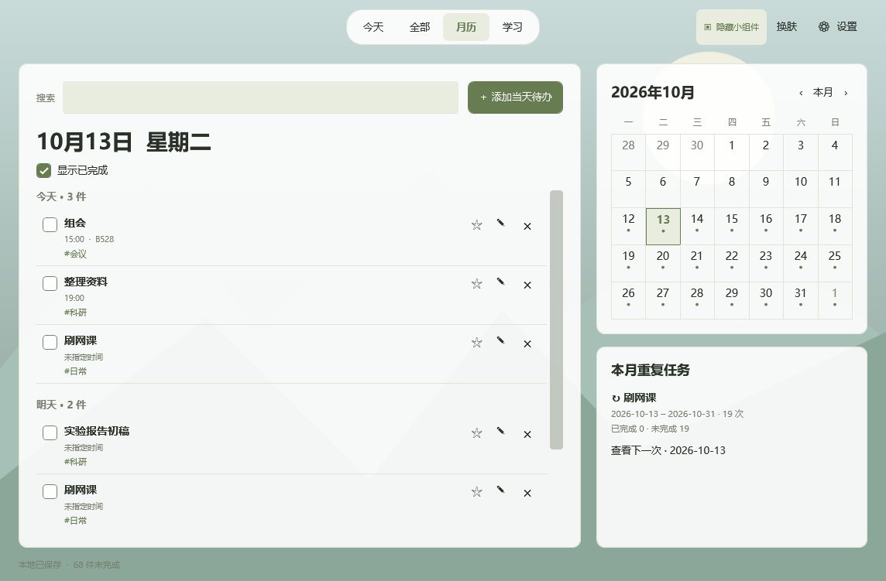

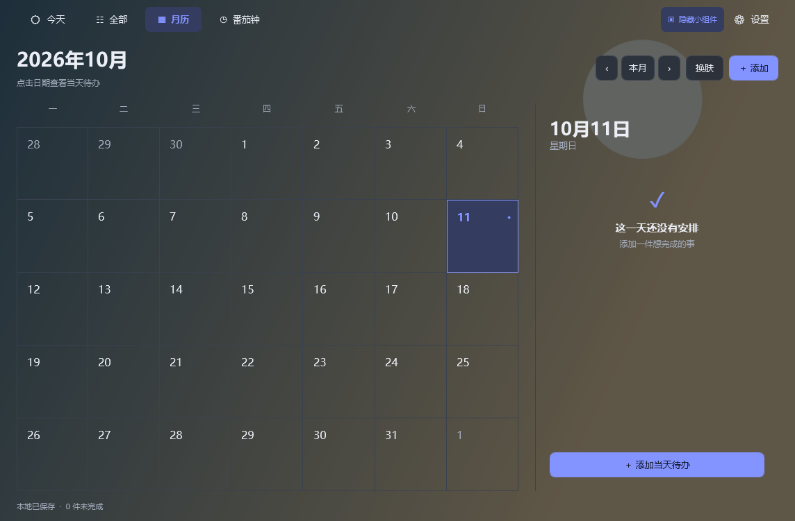

</details>

## 数据、备份与更新

数据默认保存在程序旁，也可以在“设置”中更换数据目录。

| 位置 | 内容 |
| --- | --- |
| `Data/tasks.json`，或自选数据目录中的 `tasks.json` | 待办、重复规则、学习记录、进行中计时和每日目标 |
| `preferences.json` | 数据目录、主题、背景和小组件设置 |
| 设置文件旁的 `Backgrounds/` | 导入的背景图片副本 |

保存采用校验、文件锁和原子替换，并保留上一份有效备份 `tasks.json.bak`。读取失败不会把损坏文件当成空清单覆盖。

- **导入会替换当前数据，不是合并**。请先导出备份；有未结束的学习时须先结束再导入。
- 导出数据不包含主题设置和背景图片。移动便携程序时，请保留设置、背景、数据及备份；自选目录中的数据需另行带走。
- 更新已有版本时，先从托盘退出并备份，再替换原目录中的 `拾序.exe` 与 `拾序.exe.config`，保留数据、设置、背景及其备份。
- 当前保存为 **v6 数据格式**，兼容读取 v1–v6。v1.9.0 及更早软件不能读取 v6，回退时需使用对应旧备份。

## 常见问题与限制

<details>
<summary>提醒和计时需要一直打开程序吗？</summary>

主窗口可以关闭到托盘。程序每 5 秒检查提醒；启动或恢复后补提醒当天错过且尚未提醒的事项，不补弹往日逾期任务。彻底退出、关机或睡眠期间无法通知。

学习计时在彻底退出或系统休眠时暂停，重新打开后可继续。进度每 5 秒保存，暂停和结束时立即保存；强制结束或突然断电可能丢失最近约 5 秒。当前不提供自动休息循环、开机自启或稍后提醒。

</details>

<details>
<summary>重复任务怎么修改？</summary>

每天、每周和每月按日历生成，各次任务独立操作，上次未完成也会生成下一次。每月 31 日遇到短月份落在月底，下个长月份回到 31 日。

右键“停止后续重复”会停止规则并清理后续未完成任务，保留当次及已完成记录。修改整个周期或整组内容时，停止旧规则后新建。

</details>

<details>
<summary>学习统计为什么与预设分钟数不同？</summary>

统计使用实际计时，暂停不计入；提前结束会计入时长，但不算已完成轮次。排行按完全相同的学习名称合并。“统计截至”决定图表窗口，历史记录日期可独立选择。

每日目标支持 1–1440 分钟，填 0 关闭。周报按周一至周日，月报按自然月；当前周期只统计到今天，日均包含未学习的日期。

</details>

<details>
<summary>小组件找不到了，或背景与桌面不一致？</summary>

在设置或托盘菜单中选择“找回小组件”。小组件不置顶，允许自由摆放，与桌面图标重叠时可能遮挡图标。

毛玻璃目前按壁纸“填充”布局映射，其他布局或多屏不同壁纸可能出现对齐差异。桌面接入依赖 Explorer 窗口结构，系统更新或第三方桌面工具可能影响行为。

</details>

多显示器、不同 DPI、Explorer 重启及真实休眠唤醒尚未全面验证。当前未提供安装版或代码签名。

## 开发与构建

源码使用系统自带的 C# 编译器，无需 Node.js、Python 或 NuGet 包。请确认存在 `C:\Windows\Microsoft.NET\Framework64\v4.0.30319\csc.exe`，在仓库根目录执行：

```powershell
powershell -NoProfile -ExecutionPolicy Bypass -File .\src\Build.ps1
```

产物位于 `dist/拾序/`。开发接手请先阅读 [开发约定](AGENTS.md) 和 [开发交接](docs/开发交接.md)。

<details>
<summary>检查命令与验证范围</summary>

检查必须使用 `work/` 下全新、空的目录，不能指向真实数据。以下命令每次生成独立目录名。

```powershell
# 核心逻辑检查
$coreRoot = Join-Path $PWD ('work\core-' + [Guid]::NewGuid().ToString('N'))
powershell -NoProfile -ExecutionPolicy Bypass -File .\src\Build.ps1 -TestRoot $coreRoot

# 月历与添加弹窗专项，需交互式 Windows 桌面
$uiRoot = Join-Path $PWD ('work\calendar-' + [Guid]::NewGuid().ToString('N'))
New-Item -ItemType Directory -Path $uiRoot | Out-Null
$run = Start-Process -FilePath '.\dist\拾序\拾序.exe' -ArgumentList @('--ui-test', ('"' + $uiRoot + '"'), 'calendar') -PassThru
$run.WaitForExit()
Get-Content -LiteralPath (Join-Path $uiRoot 'ui-report.txt')
```

`background` 和 `desktop` 为另外两个专项；省略第三个参数执行完整界面检查。GUI 命令返回不代表检查完成，需等待进程退出并读取报告。

v2.2.3 完成构建、十种尺寸图标解码、窗口 / 小组件 / 托盘图标加载检查及 19 项月历专项检查。此次仅更换图标，未重跑整套核心和界面检查。最近一次完整核心检查为 v2.1.0 的 104 项；最近一次较完整界面检查为 v1.10.0 的 116 项，均不代表当前版本全套验证。自动检查不能替代不同 Windows 环境中的实际使用验证。

</details>

<details>
<summary>目录与代码入口</summary>

| 目录 | 用途 |
| --- | --- |
| `src/` | C# 源码、WPF 样式、图标、构建与检查 |
| `docs/` | 使用说明、开发交接和示例截图 |
| `拾序/`、`启动拾序.lnk` | 维护者本机程序、个人数据与启动入口，Git 忽略 |
| `outputs/` | 本机发布附件，Git 忽略 |
| `dist/`、`work/` | 构建产物与临时检查目录，Git 忽略 |

`App.cs` 管应用生命周期、托盘、主题和提醒；`Core.cs` 管数据、持久化、重复规则和学习汇总；`MainWindow.cs`、`Ui.cs` 管页面与弹窗；`Focus.cs`、`StudyStats.cs` 管学习计时与统计；`WidgetWindow.cs`、`WidgetSurface.cs`、`NativeDesktop.cs` 管桌面小组件与系统接入。

新克隆的仓库不包含本机程序和个人数据，直接使用请下载 Release。便携包仅包含 `拾序.exe`、`拾序.exe.config` 和 `使用说明.md`，放在包内的 `拾序/` 目录中。不要将整个本机运行目录、个人数据、设置或背景上传到 GitHub。

</details>

## 最近更新

| 版本 | 主要变化 |
| --- | --- |
| [v2.2.3](https://github.com/XiongWen04/shixu/releases/tag/v2.2.3) | 更换为米白底绿色小鸟图标，提供 Windows 多尺寸图标 |
| [v2.2.2](https://github.com/XiongWen04/shixu/releases/tag/v2.2.2) | 月历通过“添加待办”按钮打开完整弹窗，默认日期跟随所选日 |
| [v2.2.1](https://github.com/XiongWen04/shixu/releases/tag/v2.2.1) | 恢复左侧整月大网格与右侧任务列表 |
| [v2.2.0](https://github.com/XiongWen04/shixu/releases/tag/v2.2.0) | 居中学习计时卡片、每日目标与底部学习记录抽屉 |
| [v2.1.0](https://github.com/XiongWen04/shixu/releases/tag/v2.1.0) | 自定义主窗口图片背景与遮罩 |
| [v1.10.0](https://github.com/XiongWen04/shixu/releases/tag/v1.10.0) | 每日目标、周 / 月报告、搜索与标签，数据格式升级为 v6 |

更早更新见 [GitHub Releases](https://github.com/XiongWen04/shixu/releases)。

## 图标与许可

绿色小鸟图标为本项目经 AI 辅助生成并选定的视觉资源，以纸页造型翅膀呼应记录与学习；米白底 PNG 及多尺寸 ICO 位于 `src/`。

目前尚未指定开源许可证。公开代码不等于授予使用、修改或分发许可。
