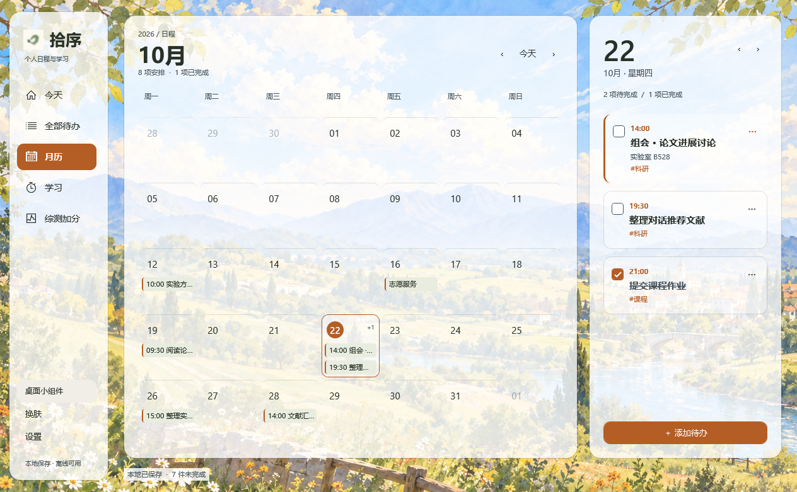
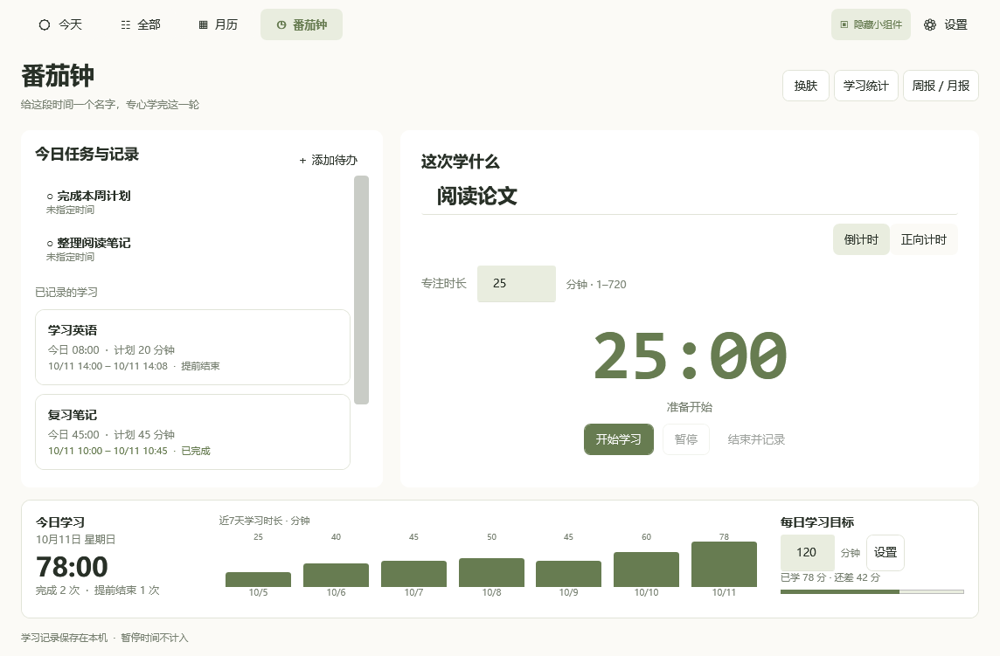
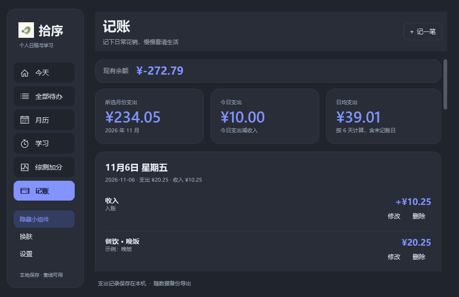
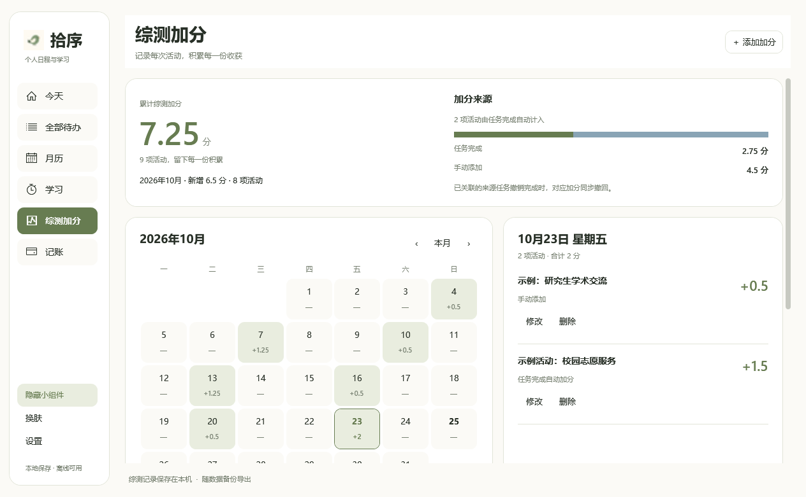

# 拾序 Shixu


**拾序是一款 Windows 桌面工具，用来安排待办、记录学习时间和管理日常收支。** 你可以在月历上排课程和截止日期，开一个计时专注学习，结束后回看实际学习时长。日常记账和综测加分也有各自的页面。

数据保存在本机，无需注册账号。当前版本为 **v2.11.2**，提供 Windows x64 便携包。

[下载便携版](https://github.com/XiongWen04/shixu/releases/download/v2.11.2/Shixu-v2.11.2-win-x64-portable.zip) · [使用说明](docs/使用说明.md) · [版本记录](https://github.com/XiongWen04/shixu/releases)



## 下载与启动

1. 下载上方的 ZIP 包，解压到有写入权限的文件夹。
2. 打开解压后的「拾序」文件夹，双击运行 `拾序.exe`。请保留同目录的 `拾序.exe.config`。
3. 打开「月历」，选中日期后点击「添加待办」。也可以按 `Ctrl+N`。

推荐使用 **Windows 11 64 位**。Windows 10 64 位需要安装 **.NET Framework 4.8**。关闭主窗口后，程序会留在系统托盘继续计时和提醒。彻底退出时，请在托盘菜单中选择「退出」。

## 功能一览

| 页面 | 可以做什么 |
| --- | --- |
| 今天、全部待办、月历 | 查看当天和逾期任务，按日期安排日程，按关键词和标签查找待办。任务支持提醒、重要标记和日、周、月重复。 |
| 学习 | 用倒计时或正向计时记录实际学习时长，设置每日目标，回看趋势、热力图和周月报告。 |
| 记账 | 逐笔登记支出和收入。设置余额后，支出扣款、收入入账。月历显示每天净支出，点击日期查看流水。 |
| 综测加分 | 手动记录活动分数，也可让完成的任务自动加分。支持累计统计、活动月历和跨月记录。 |
| 桌面小组件和换肤 | 在桌面查看和完成待办。小组件可移动和缩放，主窗口支持三套主题、内置风景皮肤和自定义背景。 |

## 界面预览

### 学习计时

选择倒计时或正向计时，输入学习名称即可开始。暂停时间不会计入学习时长，结束后可以在学习统计里查看记录。



### 收支记账

在「记账 → 记一笔」里选择支出或收入，填写金额、日期和可选备注。餐饮支出可细分早饭、午饭、晚饭和其他。当天支出 30 元、收入 20 元时，顶部今日支出、月历当天格和当天汇总都显示 **10 元净支出**，逐笔明细分别显示扣款和入账。



### 综测加分

可以单独添加一条活动记录，也可以给待办设置加分，完成后自动计入。点月历日期查看当天明细，点「全部记录」跨月份查找。



## 本地数据与更新

| 文件或目录 | 保存内容 |
| --- | --- |
| `Data/tasks.json` | 待办、学习记录、综测加分、收支流水和余额。设置中可以另选数据目录。 |
| `preferences.json` | 数据目录、主题、背景和小组件位置等设置。 |
| `Backgrounds/` | 导入的自定义背景副本。 |

更新前，请先从托盘退出并备份。把新版本的程序和配置替换到原目录，保留数据、设置、背景以及备份。**导入备份会替换当前数据**，导入前请先导出一份。当前数据格式为 v12，回退到 v2.10.1 或更早版本时需要使用对应的旧备份。

如果双击中文文件名的程序没有反应，可以把程序和配置分别改名为 `Shixu.exe` 和 `Shixu.exe.config`，然后再启动。更多操作见 [使用说明](docs/使用说明.md)。

## 从源码构建

项目使用 C#、WPF 和 .NET Framework 4.8。在 Windows 上克隆仓库后，从根目录执行以下命令。

```powershell
powershell -NoProfile -ExecutionPolicy Bypass -File .\src\Build.ps1
```

构建产物在 `dist/拾序/`。开发约定和验证入口见 [AGENTS.md](AGENTS.md) 与 [开发交接](docs/开发交接.md)。问题反馈可提交到 [GitHub Issues](https://github.com/XiongWen04/shixu/issues)。

本仓库目前尚未指定开源许可证。
